# Fraza: Real-World Language Companion

**Capture the phrases you actually need. Express yourself naturally.**

Fraza is built for learners who already have a basic grasp of a language, helping them overcome the hurdle of getting stuck on real-life phrasing. Record yourself living your day — a conversation with your kids, rehearsing for a work call — in sessions up to 30 minutes long. Each recording is transcribed right away, and AI makes it easy to pull out exactly the lines worth practicing and turn them into cards. Pick the tone and translation style per context — work, time with your kid, a trip — so each card matches where it was actually captured. Short, roughly five-minute practice sessions turn review into a daily habit, so your phrasing improves faster and you actually notice it.

---

## Contents

- [📱 Screenshots](#-screenshots)
- [🔧 How it works](#-how-it-works)
  - [🌍 Contexts](#-contexts)
  - [🔴 Record](#-record)
  - [➕ Add tab](#-add-tab)
  - [📋 Practice tab](#-practice-tab)
  - [🎙️ Transcripts tab](#️-transcripts-tab)
  - [🔩 Setup tab](#-setup-tab)
- [🧱 Stack](#-stack)
- [💾 Backup](#-backup)
- [🔔 Reminders, and what leaves this device](#-reminders-and-what-leaves-this-device)
- [🔑 Keys, and what actually protects your data](#-keys-and-what-actually-protects-your-data)
- [🚀 Setup](#-setup)
  - [1. Get a Gemini API key](#1-get-a-gemini-api-key)
  - [2. Open the app and install it](#2-open-the-app-and-install-it)

---

## 📱 Screenshots

  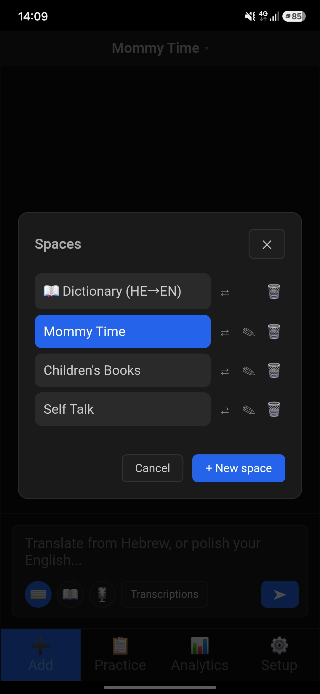
  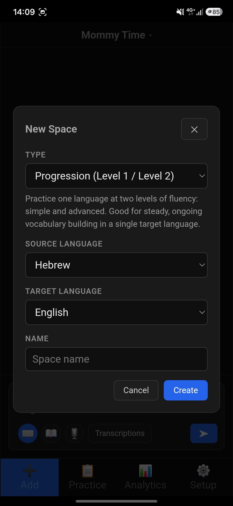
  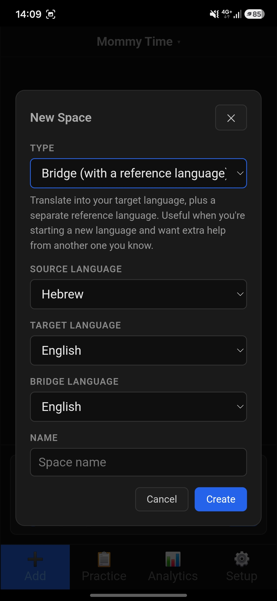
  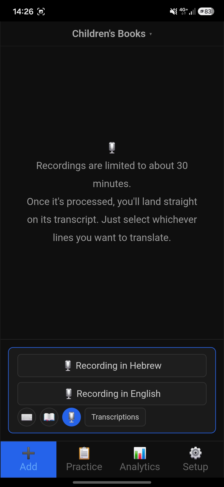

  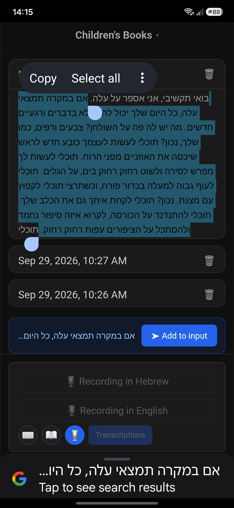
  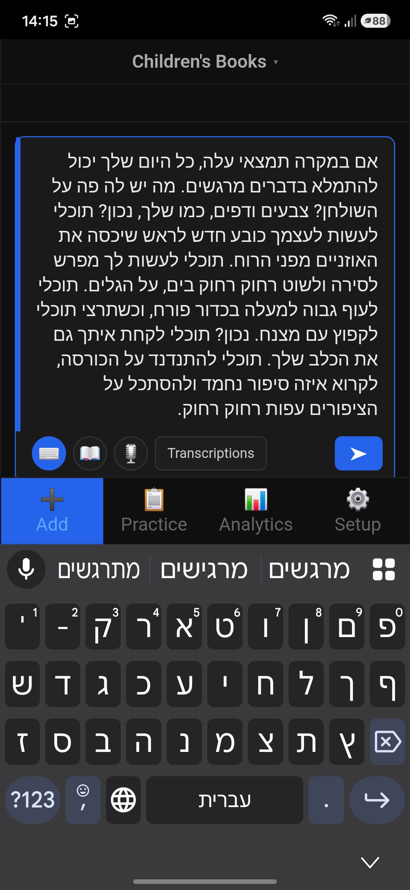
  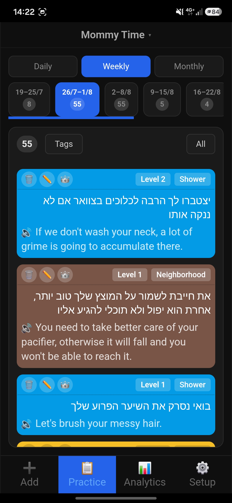
  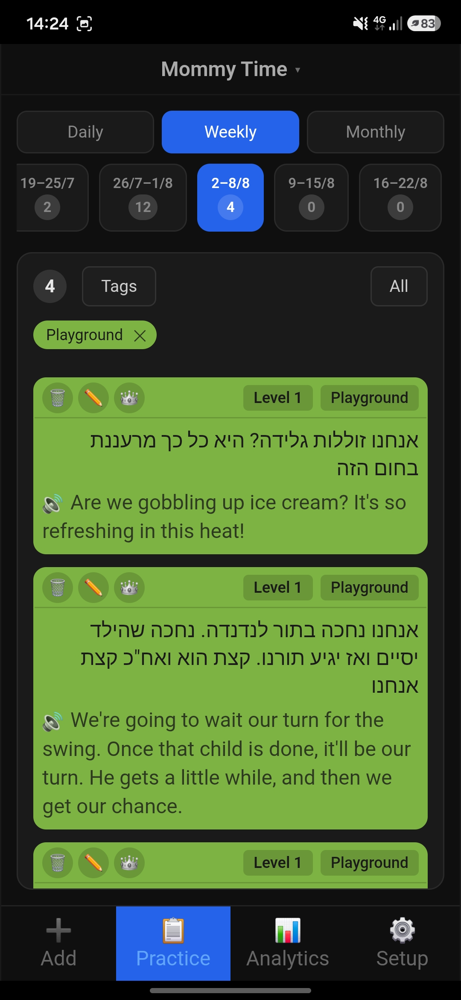

  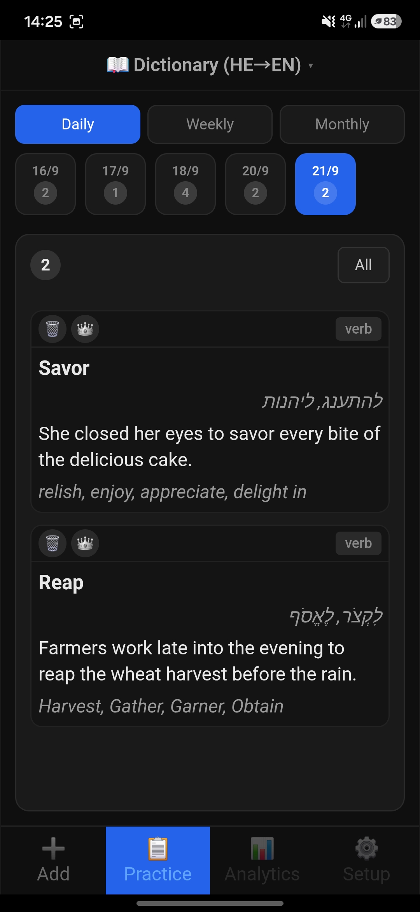
  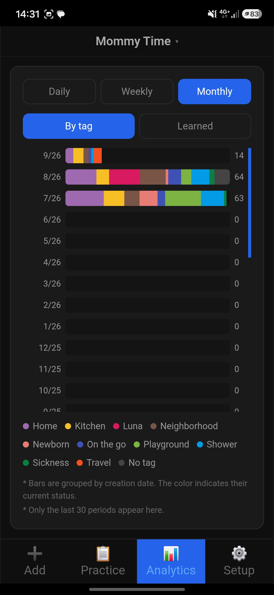
  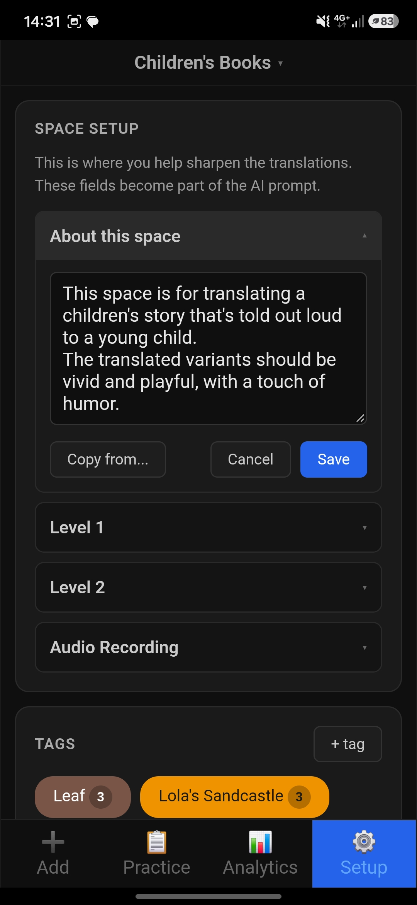
  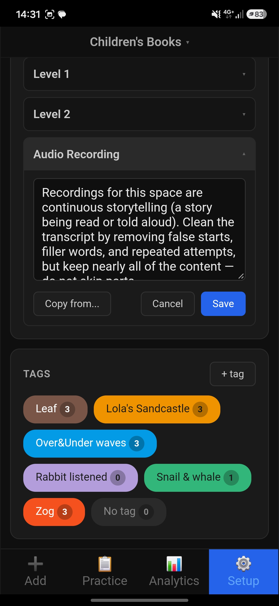

> These screenshots are from an earlier version of the app and haven't been retaken since the redesign described below

---

## 🔧 How it works

### 🌍 Contexts

The app always shows exactly one active context, named in the header at the top of every tab. Tap the name to switch to another context, or create a new one. Creating a context asks for:

- **Type**:
  - **Progression** — practice one language at two levels of fluency, simple and advanced. Good for steady, ongoing vocabulary building in a single target language.
  - **Bridge** — translate into your target language, plus a separate reference language. Useful when you're starting a new language and want extra help from another one you already know.
  - **📖 Dictionary** — a standalone word-lookup list: look up individual words and save their definitions, synonyms, and an example sentence. Has no time slots, Transcripts tab, or Setup tab of its own — just word lookups and practice.
- **Source/target language** (plus a **bridge language** for Bridge contexts), each chosen from a fixed list so every language's name and code stay consistent everywhere.

You can also **⇄ migrate** one context into another — this moves its phrases and transcripts into the target context.

### 🔴 Record
 
A single red button sits in the middle of the bottom tab bar; tap it, pick which context the recording belongs to, then record straight from the microphone (Android/Chrome) for up to 30 minutes — tap again to stop.
 
On browsers without in-browser recording support (iOS Safari, mainly), this button is hidden, and the Add tab's own 🎙️ Record mode (below) — picking an existing recording file instead — is the way in.
 
Either way, as soon as a recording finishes processing, the app jumps straight to the **Transcripts** tab with that fresh transcript already open, ready to pick lines out of.

### ➕ Add tab

A single text input, with three small icon buttons (**⌨️ 📖 🎙️**).

- **⌨️ Type** (the default):
  - Write in the context's source or target language (or a mix — a phrase, a sentence, a short paragraph) and hit Send.
  - The language is detected automatically, so there's nothing to pick beforehand: source-language text gets translated, target-language (or mixed) text gets grammar/phrasing-corrected instead.
  - Saved right away as a card — you'll see it in the Practice tab — and automatically tagged with whichever time slot is active right now, if any (see Practice tab below) — no AI involved in that decision, it's a plain time-of-day lookup.
- **📖 Dictionary**:
  - Look up a word in the context's source or target language.
  - Doesn't require switching to a dictionary context at all — if more than one dictionary context exists, a quick picker asks which one first (if there's only one, it's used directly; if there are none yet, you're told to create one).
  - if what you typed doesn't match the selected icon (a single word while ⌨️ Type is active, or a full phrase while 📖 Dictionary is active), a quick prompt offers to send it the other way instead — catches the easy mistake of forgetting which mode is selected.
- **🎙️ Record**:
  - Swaps the text input out for two buttons — "Recording in {source language}" and "Recording in {target language}" — telling the AI up front which language to expect, making it easier to identify correctly in audio. Typed text doesn't need this hint, since the language is already obvious from the text itself.
  - Opens the file picker to select an existing recording of up to ~30 minutes — the fallback for browsers that can't record straight from the microphone (see 🔴 Record above for the always-available in-browser option).

### 📋 Practice tab

Your full phrase list as cards — in a dictionary context, each card is a looked-up word instead of a phrase.
 
- **The schedule strip** is where you set the moments in your day worth capturing from. Each one gets a notification shortly beforehand, nudging you to record yourself living that part of your day. Anything you capture during that window gets labeled with it automatically, so afterward you can look back at exactly what came out of each part of your day.
  - Shows every context's slots, not just the active context's.
  - A slot belonging to the **active** context is tappable: tap it to see just what you captured during that window, with its own phrase count shown right on the pill.
  - An extra **"Unlabeled"** pill (its own context's name shown underneath, same as a real slot) covers anything captured outside any window.
  - A slot belonging to a **different** context stays informational only — no count, nothing to tap.
  - In a dictionary context (no slot concept at all), the whole strip is purely informational.
- **Cards** have:
  - **Level / language code badge**: toggles which translation is shown — "Level 1"/"Level 2" in a progression context, or the actual language code (e.g. "EN"/"CS") in a bridge context, since there variant 2 is a different language, not a more advanced version of variant 1.
  - **Slot badge**: shows which time slot the card belongs to (or "Assign to slot" if it has none yet) — tap to reassign it.
  - **✏️**: edit a phrase's wording, re-translating it in place.
  - **🗑️**: delete, with a confirm.
  - **🔊**: hear the shown variant spoken aloud — generated once on first play and cached on this device from then on.
  - A card created over a month ago gets a small "🕓 Created over a month ago" note — just a nudge to go delete it if it's not useful any more; nothing is ever deleted automatically.
- **Select**: a toolbar toggle for multi-select — pick several cards, then **Move to...** moves them all into another context at once, or **🎯 Start practice** drills exactly that selection.
- **🎯 Practice** — a short, self-graded practice session, the actual daily-review habit loop:
  - Pick a scope first: a random sample from the whole context, specific time slots, or (via Select, above) a manual pick of exact cards.
  - Each unit shows the phrase's source-language sentence, lets you try saying/typing your own attempt (never saved anywhere, not even temporarily), then reveals the real wording it was actually captured/corrected to.
  - A phrase recorded as several sentences back-to-back is drilled one sentence at a time; on the very last sentence (or a dictionary word's own single unit) you choose **Continue** (keep it — just marks it as recently practiced, so future sessions prioritize other things) or **Delete** (it's solid enough that there's no reason to keep seeing it).
  - A session targets about 7 units, prioritizing whatever hasn't been practiced in a while.
  - In a dictionary context, practice skips the scope picker and just starts a session over the whole context.

### 🎙️ Transcripts tab

Every recording lands here as its own entry, kept for 24 hours and then deleted automatically; tap ⭐ on one to pin it and keep it indefinitely.

Opening a transcript shows its text broken up into individual, tappable sentences — this is how you pick which lines actually become phrase cards:

- **Tap a sentence** to select/deselect it.
- **Select all**, then deselect the few exceptions — handy when most of a recording is worth keeping (reading a story aloud, practicing for an interview).
- **🔗 Range** — tap it, then tap the first and last sentence you want, and everything between gets selected in one go.
- **AI suggestions**: the AI also highlights sentences worth a card — solid for a strong candidate, dotted for a maybe. Just a hint: nothing is created without a tap, and picking lines by hand always works too.
- **➤ Send** translates and saves everything currently selected, one at a time, logging each result right there — repeat for as many batches as you like, the transcript stays open throughout.

### 🔩 Setup tab

Not shown at all for a dictionary context.

- **Appearance** — switch between **🌙 Dark** (default) and **☀️ Light** mode.
- **Schedule** — this context's own time slots.
  - Each slot has a name, a "Notify at" time (when the reminder fires), an "Active until" time (how long its window stays open for labeling anything captured during it), and a color shared across every context in the app, so no two slots anywhere clash.
  - Each slot has its own on/off toggle for push reminders — turning one on is what triggers the browser's notification-permission prompt the first time.
  - See [🔔 Reminders](#-reminders-and-what-leaves-this-device) below for how the actual push works, and for a phone setting worth double-checking if a reminder isn't showing up.
  - "+ Add slot" itself lives in the Practice tab's toolbar, not here.
- **Backup** — export or import all your data. See [💾 Backup](#-backup) below.
- **Invite a friend** — copies a ready-to-send message with the app's link to your clipboard, to paste into WhatsApp or wherever, so you don't have to type it out each time.
- **Translation & Transcription Guidelines** — this is where you help sharpen the translations: each field you fill in becomes part of the AI prompt that shapes this context's transcription and translation. Four fields, each opening one at a time with its own Save/Cancel and a "Copy from..." option to pull that field's content from another context:
  - **About this context** — who's speaking, common topics, and terminology particular to this context, so translations sound like they belong in it.
  - **Level 1 / Level 2** (labeled with the actual target/bridge language names in a Bridge context) — how each level should sound: Level 1 sets the baseline phrasing, Level 2 a step up in fluency from it. In a Bridge context, the second field shapes how that reference-language translation should sound so that it actually helps you learn the target language.
  - **Audio Recording** — anything that helps transcribe this context's recordings accurately: background noise to expect, long silences, or other quirks particular to how you record.

---

## 🧱 Stack

| Piece                           | Technology                                                   |
| -------------------------------- | -------------------------------------------------------------- |
| Translation & audio processing  | Google Gemini (`gemini-3.6-flash`), called straight from the browser |
| Text-to-speech                  | Google Gemini TTS (`gemini-3.1-flash-tts-preview`), called straight from the browser |
| Storage                         | IndexedDB, built into the browser — your phrases, transcripts, and contexts never leave this device unless you export them |
| Reminders                       | OneSignal (Web Push) + a small Cloudflare Worker that decides when each slot's reminder is due — see [🔔 Reminders](#-reminders-and-what-leaves-this-device) below |
| Hosting                         | Any static file host (GitHub Pages, Netlify, or your own computer for local use) — plain HTML/CSS/JS, no build step, no server process for the app itself |
| App install                     | PWA (manifest + service worker)                                |

---

## 💾 Backup

Your actual data — contexts, phrases, transcripts — lives only in this device's browser storage (IndexedDB). On first launch on any device, it asks once for your Gemini API key, and remembers it on that device from then on (see [🔑 Keys, and what actually protects your data](#-keys-and-what-actually-protects-your-data)).

Since your data lives only on this device, **Backup** (in the Setup tab) is the only way it ever moves anywhere else. Two reasons you'd use it:

- **A safety copy** — in case you clear your browser's data, lose the device, or something goes wrong. Export every so often and keep the file somewhere safe (email it to yourself, save it to Drive, etc.).
- **Switching devices** — export on the old device, then import that same file on the new one, to carry everything over.

**Export** reads everything — every context, phrase, dictionary entry, and transcript — and downloads it as a single `.json` file, then opens your mail app with a draft reminding you to attach it. Browsers can't attach a downloaded file to an email automatically, so you still need to attach it yourself from Downloads if you're sending it somewhere.

**Import** reads a file produced this way and restores it onto this device. It's meant for restoring into a fresh install, not for merging two devices that have each been used independently: importing overwrites any existing row that shares an ID with the file, rather than combining them. If you've used two devices separately and want everything in one place, there's no automatic way to merge them — you'd need to pick one device's data as the one to keep.

---

## 🔔 Reminders, and what leaves this device

Reminders are the one feature that genuinely needs something outside this device: a push notification has to be delivered by someone while the app itself isn't running, which a purely local, no-backend app can't do on its own.

**What actually leaves this device:** only a slot's name, its notify/active times, its color, this device's timezone, and a push-subscription id handed out by the browser's own push service (via OneSignal) — sent to a small Cloudflare Worker (`fraza-notify`) whenever a slot changes. The Worker runs on a schedule, decides which slots are due, and asks OneSignal's API to deliver the push — it's the only place holding OneSignal's own secret key.

There's no login or account tying this to you personally — the Worker just recognizes this browser by a random id it generates once and stores locally, same spirit as the device-scoped audio cache.

**If a reminder doesn't show up:** the Setup tab's Schedule section shows a banner if your browser has push notifications blocked outright. But on some Android phones there's a second, OS-level setting worth checking too, since by default it hides the very setting that actually controls this:
 
1. In your phone's notification settings, find **Advanced settings** and turn on **Manage notification categories for each app** — without this, the per-category setting in step 7 won't even be visible.
2. Open **App notifications**, and pick **Fraza**.
3. Turn on **Allow notifications**.
4. Turn on **Sound and vibrate**.
5. Set **Notification pop-up style** to **Brief pop-up**.
6. Set **Show or hide content when locked** to **Always show**.
7. Now that categories are visible, open **Notification categories** and set it to **General**.

---

## 🔑 Keys, and what actually protects your data

Your Gemini API key lives only in this device's browser storage (`localStorage`), never in the repo. It isn't encrypted beyond that.

**How someone could actually get it:**

1. **A rooted/jailbroken phone** — breaks the OS sandbox that normally keeps one app from reading another app's storage.
2. **A malicious browser extension** — installed in the same browser, with permission to read page content.
3. **Physical access to an unlocked phone, or forensic recovery tools** — reads device storage directly.

Put simply: it can't be stolen unless your phone is already compromised (rooted/jailbroken) or physically in someone else's hands. Short of that, the browser itself is what keeps it safe — every website gets its own completely isolated storage, so no *other* app on your phone and no *other* website you visit can ever read Fraza's `localStorage`. Installing Fraza as a PWA doesn't change any of this — it still runs inside the browser's engine, under that same storage isolation, like any website.

The same is true of your actual data — your phrases, transcripts — which also lives only in this device's browser storage (IndexedDB), nowhere else, while the recording itself is never stored anywhere at all, only the resulting transcript text is kept.

---

## 🚀 Setup

Total setup time: roughly 2 minutes. Nothing to install on a computer, no account to create — just a key and a link.

### 1. Get a Gemini API key

- Go to **aistudio.google.com** → **API Keys** in the left sidebar → **Create API Key** (pick or create a Google Cloud project if prompted).
- You'll paste this into the app itself in step 2 — it isn't needed anywhere else.

### 2. Open the app and install it

- Open **[rotemhonpauker.github.io/EnglishTutor](https://rotemhonpauker.github.io/EnglishTutor/)** on your phone (or computer).
- The first time, it asks for your Gemini API key — paste the one from step 1. It's saved on this device and won't ask again.
- To install it as an app on your phone: "Add to Home Screen" (Safari, via the share button) or "Install app" (Chrome, via the ⋮ menu). It opens full-screen from then on, like a native app.
- Repeat this once per new device (phone, another computer) — nothing carries over between devices on its own, except what you move yourself with **Backup** (export on the old device, import on the new one — see [💾 Backup](#-backup) above).