# Fraza: Real-World Language Companion

**Capture the phrases you actually need. Express yourself naturally.**

Fraza is built for learners who already have a basic grasp of a language, helping them overcome the hurdle of getting stuck on real-life phrasing. Instead of teaching grammar or pronunciation from scratch, the app lets you capture flashcards from short typed notes, word lookups, or hands-free voice recordings up to 30 minutes long. Custom AI prompts automatically generate dual translations tailored to your preferred tone, register, or even a third reference language. You can organize your phrases into dedicated spaces — such as work, parenting, or travel — with custom tags and personal prompts. With an integrated personal dictionary and smart transcript filtering, Fraza turns your everyday routine into a tailored vocabulary collection.

---

## Contents

- [📱 Screenshots](#-screenshots)
- [🔧 How it works](#-how-it-works)
  - [🌍 Spaces](#-spaces)
  - [➕ Add tab](#-add-tab)
  - [📋 Practice tab](#-practice-tab)
  - [📊 Analytics tab](#-analytics-tab)
  - [🔩 Setup tab](#-setup-tab)
- [🧱 Stack](#-stack)
- [🔊 Text-to-speech & recording privacy](#-text-to-speech--recording-privacy)
- [🔑 Keys, and what actually protects your data](#-keys-and-what-actually-protects-your-data])
- [🚀 Setup](#-setup)
  - [1. Create the Supabase project and database](#1-create-the-supabase-project-and-database)
  - [2. Create your sign-in user](#2-create-your-sign-in-user)
  - [3. Get a Gemini API key](#3-get-a-gemini-api-key)
  - [4. Run it locally](#4-run-it-locally)
  - [5. Publish it so you can install it on your phone](#5-publish-it-so-you-can-install-it-on-your-phone)
  - [6. First launch, on any device](#6-first-launch-on-any-device)

---

## 📱 Screenshots

<p align="center">
  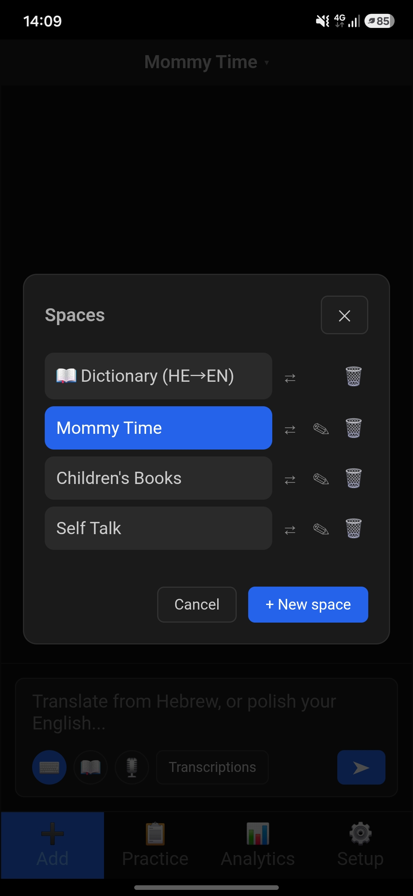
  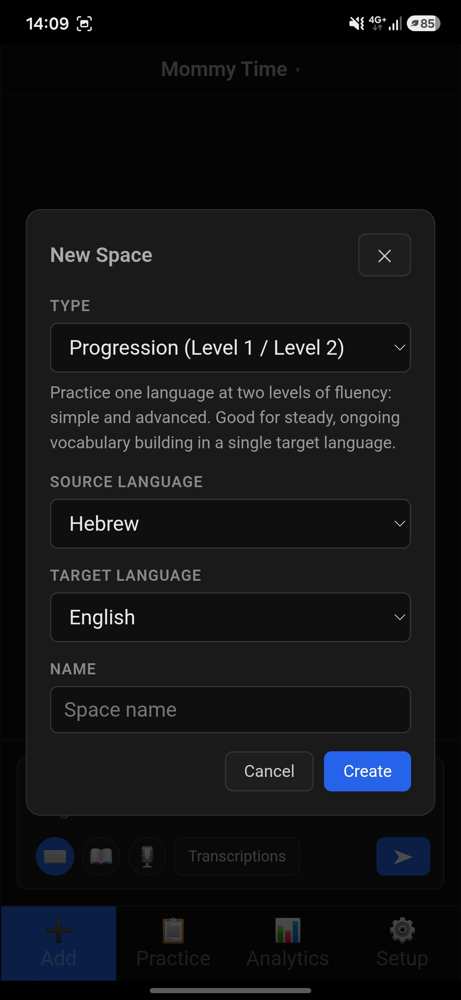
  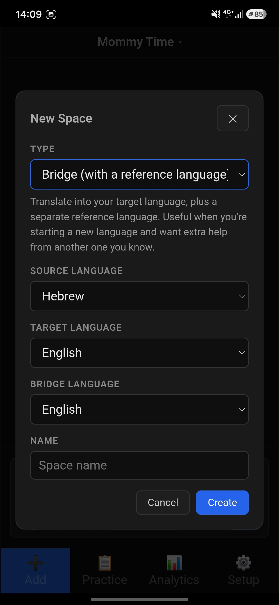
  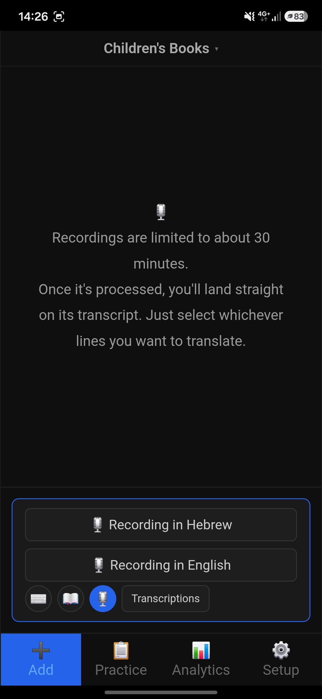
</p>
<p align="center">
  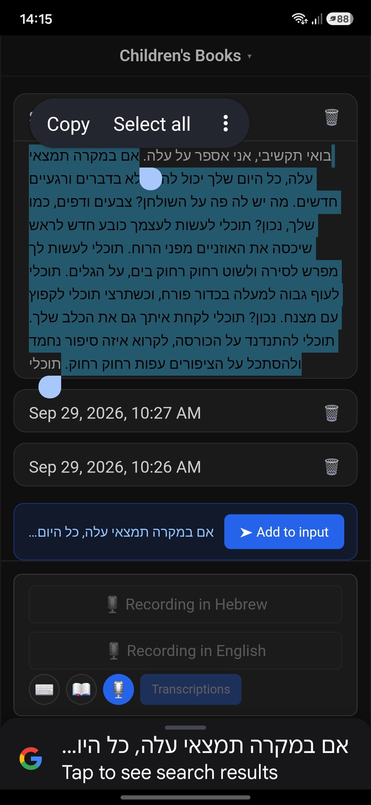
  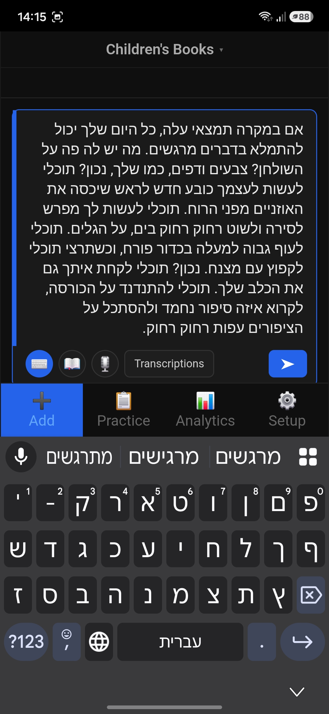
  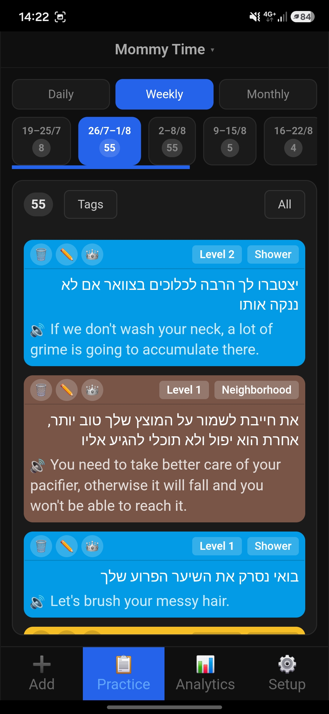
  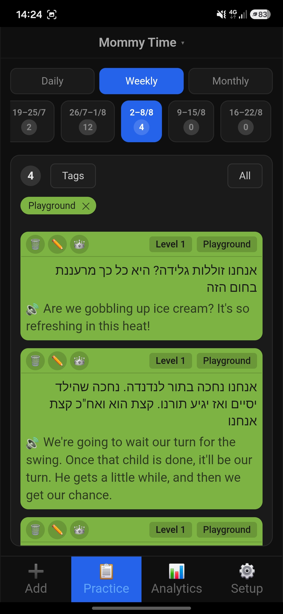
</p>
<p align="center">
  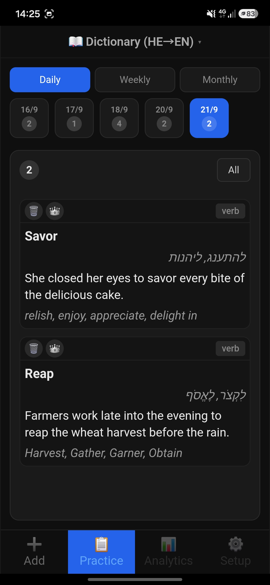
  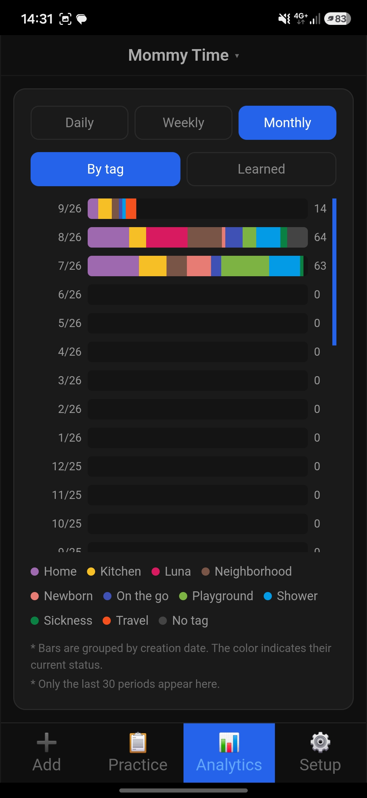
  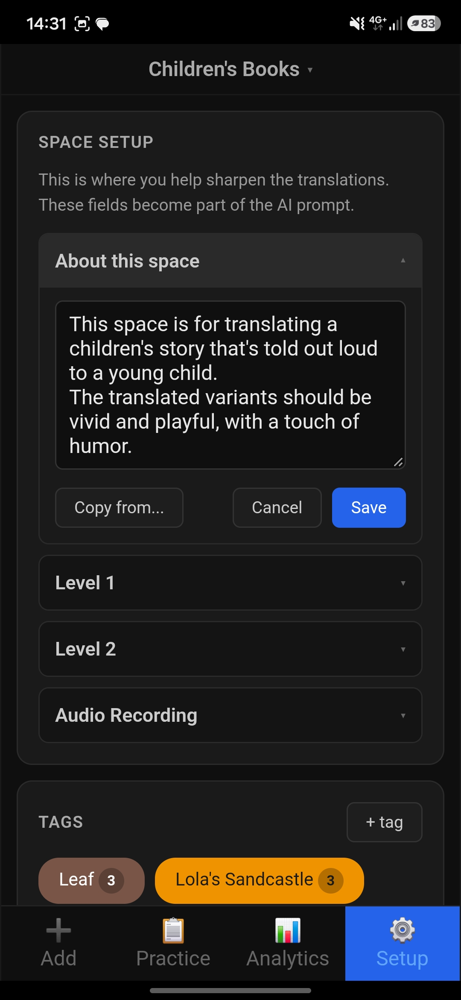
  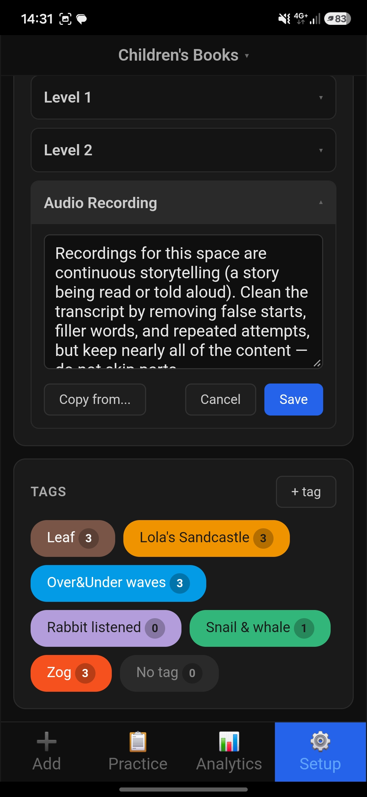
</p>

---

## 🔧 How it works

### 🌍 Spaces

The app always shows exactly one active space, named in the header at the top of every tab. Tap the name to switch to another space, or create a new one. Creating a space asks for:

- **Type**:
  - **Progression** — practice one language at two levels of fluency, simple and advanced. Good for steady, ongoing vocabulary building in a single target language.
  - **Bridge** — translate into your target language, plus a separate reference language. Useful when you're starting a new language and want extra help from another one you already know.
  - **📖 Dictionary** — a standalone word-lookup list: look up individual words and save their definitions, synonyms, and an example sentence.
- **Source/target language** (plus a **bridge language** for Bridge spaces), each chosen from a fixed list so every language's name and code stay consistent everywhere.

You can also **⇄ migrate** one space into another — this moves its phrases, tags, and transcripts into the target space.

### ➕ Add tab

A single text input, with three small icon buttons (**⌨️ 📖 🎙️**) plus a **Transcriptions** toggle.

- **⌨️ Type** (the default):
  - Write in the space's source or target language (or a mix — a phrase, a sentence, a short paragraph) and hit Send.
  - The language is detected automatically, so there's nothing to pick beforehand: source-language text gets translated, target-language (or mixed) text gets grammar/phrasing-corrected instead.
  - Saved right away into the **capture log**.
  - The same AI call also tries to match it to one of the space's existing tags, only when confident — otherwise it's left untagged, and you can always tag or retag it yourself from Practice.
- **📖 Dictionary**:
  - Look up a word in the space's source or target language.
  - Doesn't require switching to a dictionary space at all.
  - If more than one dictionary space exists, a quick picker asks which one first (if there's only one, it's used directly; if there are none yet, you're told to create one).
- **Mode mismatch check**: if what you typed doesn't match the selected icon (a single word while ⌨️ Type is active, or a full phrase while 📖 Dictionary is active), a quick prompt offers to send it the other way instead — catches the easy mistake of forgetting which mode is selected.
- **🎙️ Record**:
  - Swaps the text input out for two buttons — "Recording in {source language}" and "Recording in {target language}" — telling Gemini up front which language to expect, making it easier to identify correctly in audio. Typed text doesn't need this hint, since the language is already obvious from the text itself.
  - Then opens the file picker to select a recording of up to ~30 minutes.
  - As soon as a recording finishes processing, the view jumps straight to **Transcriptions** with that fresh transcript already expanded.
- **Transcriptions**:
  - Swaps the whole capture log area over to a list of past recording transcripts.
  - Tap one to expand/collapse it, or delete it once you're done; a nudge appears once more than 3 are saved.
  - Selecting text inside an expanded transcript surfaces an "Add to input" bar — tap it to drop that exact selection into the input (switching to ⌨️ automatically), edit if needed, then Send, same as typing it fresh.
  - Repeat per phrase.

### 📋 Practice tab

Your full phrase list as cards — in a dictionary space, each card is a looked-up word instead of a phrase.

- **A horizontal date strip up top** (Daily / Weekly / Monthly): jumps to a specific day, week, or month. The strip covers the most recent 30 days/weeks/months (periods with nothing in them are skipped, so it's not always a full 30 pills) — anything before that falls into a single "Older" bucket at the start. Works the same in a dictionary space.
- **Filters**: a learned/not-learned filter always applies; a tag filter is layered on top of it in progression/bridge spaces (dictionary entries aren't tagged).
- **Progression/Bridge cards** have these buttons:
  - **Tag**: tap to tag the card — applies the tag's color to the whole card.
  - **Level / Language code**: each card shows only its current level's wording. A badge next to the tag toggles which one, independent of learned state — "Level 1"/"Level 2" in a progression space, or the actual language code (e.g. "EN"/"CS") in a bridge space, since there variant 2 is a different language, not a more advanced version of variant 1.
  - **👑**: tap to mark a phrase learned — it stays in the list, just dimmed with a gold accent; nothing disappears.
  - **✏️**: tap to edit a phrase's wording. Overwrites that phrase in place — same `id`, same `created_at`, same tag. Cached audio is cleared.
  - **🗑️**: tap to delete.
  - **🔊**: tap to hear the shown variant spoken aloud — generated once on first play and cached from then on, so repeat listens never call the API again.
- **Dictionary cards** show the word itself, its part of speech, synonyms in both languages, and an example sentence — with just two buttons:
  - **👑**: tap to mark a word learned, same as a phrase.
  - **🗑️**: tap to delete.
- **Select**: a toolbar toggle for multi-select — pick several cards, then **Move to...** moves them all into another space at once. Level and learned status carry over; tags don't, since a tag belongs to the space you're leaving.

### 📊 Analytics tab

A horizontal stacked-bar chart.

- One row per day/week/month (same Daily / Weekly / Monthly toggle as Practice), scrolling vertically with the most recent period at the top.
- A second toggle switches what each bar breaks down by:
  - **By tag**: color-coded per tag, plus a "no tag" segment.
  - **Learned**: how much of what was created in that period is now marked learned vs. not, as of right now.
- Both toggles group phrases by _when they were added_, not by when they reached their current status.
- Not shown at all for a dictionary space.

### 🔩 Setup tab

Not shown at all for a dictionary space.

- **Appearance** — switch between **🌙 Dark** (default) and **☀️ Light** mode.
- **Space Setup** this is where you help sharpen the translations: each field you fill in becomes part of the AI prompt that shapes this space's transcription and translation. Four fields, each opening one at a time with its own Save/Cancel and a "Copy from..." option to pull that field's content from another space:
  - **About this space** — who's speaking, common topics, and terminology particular to this space, so translations sound like they belong in it.
  - **Level 1 / Level 2** (labeled with the actual target/bridge language names in a Bridge space) — how each level should sound: Level 1 sets the baseline phrasing, Level 2 a step up in fluency from it. In a Bridge space, the second field shapes how that reference-language translation should sound so that it actually helps you learn the target language.
  - **Audio Recording** — anything that helps transcribe this space's recordings accurately: background noise to expect, long silences, or other quirks particular to how you record.
- **Tags** — a flat set of tags per space (a chip cloud, each with a color and phrase count). Tap one to edit it, merge it into another tag, or delete it.

---

## 🧱 Stack

| Piece                          | Technology                                                                                                                             |
| ------------------------------ | -------------------------------------------------------------------------------------------------------------------------------------- |
| Translation & audio processing | Google Gemini (`gemini-3.6-flash`), called straight from the browser                                                                   |
| Text-to-speech                 | Google Gemini TTS (`gemini-3.1-flash-tts-preview`), called straight from the browser                                                   |
| Database                       | Postgres via Supabase, queried directly from the browser (`supabase-js`)                                                               |
| Auth                           | Supabase Auth — a single account, sign-ups disabled                                                                                    |
| Data protection                | Postgres Row Level Security, scoped to the signed-in user                                                                              |
| Hosting                        | Any static file host (GitHub Pages, Netlify, or your own computer for local use) — plain HTML/CSS/JS, no build step, no server process |
| App install                    | PWA (manifest + service worker)                                                                                                        |

There's no backend at all — the app is a set of static files. On first launch on any device, it asks once for your Supabase project's URL/key and your Gemini API key, and remembers them on that device from then on (see [🔑 Keys, and who can see your data](#-keys-and-who-can-see-your-data)). Everything else — your data's actual security — comes from Supabase Auth plus Row Level Security, not from keeping any of this hidden.

---

## 🔊 Text-to-speech & recording privacy

- Tapping 🔊 next to a variant generates spoken audio via Gemini TTS (voice: **Achernar**) the first time only — the audio is saved as a file in your browser's own local storage (IndexedDB) on that device, keyed by phrase + variant. Every play after that just reads the cached file, no API call. This means TTS audio is **per device, not shared** — playing a phrase on your phone for the first time will generate it again there, even if you'd already played it on your computer. Deleting a phrase deletes its cached audio too, so nothing lingers with no phrase pointing to it.
- A recording itself is never stored anywhere — only the resulting transcript text (saved to `transcripts`) survives past the request, and nothing else, until you select something from it.

---

## 🔑 Keys, and what actually protects your data

Three values live only in this device's browser storage (`localStorage`), never in the repo: the Supabase URL + publishable key, your login password, and your Gemini key. None of them are encrypted beyond that.
 
**How someone could actually get them:**
 
1. **A rooted/jailbroken phone** — breaks the OS sandbox that normally keeps one app from reading another app's storage.
2. **A malicious browser extension** — installed in the same browser, with permission to read page content.
3. **Physical access to an unlocked phone, or forensic recovery tools** — reads device storage directly.

Put simply: these keys can't be stolen unless your phone is already compromised (rooted/jailbroken) or physically in someone else's hands. Short of that, the browser itself is what keeps them safe — every website gets its own completely isolated storage, so no *other* app on your phone and no *other* website you visit can ever read Fraza's `localStorage`. That's a basic security guarantee all browsers enforce (per-site/per-origin isolation), on top of the normal OS-level sandboxing that keeps apps separate from each other in general. Installing Fraza as a PWA doesn't change any of this — it still runs inside the browser's engine, under that same storage isolation, like any website.
 
What actually protects your data, beyond these three values, is one layer deeper: **Supabase Auth + Row Level Security** (set up in step 1 below). Even someone who gets all three values still can't read or write your rows without also being signed in as you.
 
**Never** put a Supabase **service_role** key anywhere in this app, in any form. That one really is secret, and bypasses Row Level Security entirely — everything above assumes it's never used here.

---

## 🚀 Setup

Total setup time: roughly 15–20 minutes.

### 1. Create the Supabase project and database

- Provider: supabase.com → New project. Choose a project name and a region; the database password it asks you to set here is a separate thing from your app login (step 2) — you won't need it day to day, so a generated one is fine.
- Once the project is ready, open **SQL Editor → New query**, and run these three scripts in order:

**`01-schema.sql`** — creates the five tables:

```sql
CREATE TABLE spaces (
    id UUID PRIMARY KEY DEFAULT gen_random_uuid(),
    name TEXT NOT NULL,
    space_type TEXT NOT NULL DEFAULT 'progression',
    source_language TEXT NOT NULL,
    target_language TEXT NOT NULL,
    bridge_language TEXT,
    about_this_space TEXT,
    variant_1_notes TEXT,
    variant_2_notes TEXT,
    audio_recording_notes TEXT,
    created_at TIMESTAMPTZ NOT NULL DEFAULT now()
);

CREATE TABLE tags (
    id UUID PRIMARY KEY DEFAULT gen_random_uuid(),
    space_id UUID NOT NULL REFERENCES spaces(id),
    name TEXT NOT NULL,
    color TEXT,
    created_at TIMESTAMPTZ NOT NULL DEFAULT now()
);

CREATE TABLE phrases (
    id UUID PRIMARY KEY DEFAULT gen_random_uuid(),
    space_id UUID NOT NULL REFERENCES spaces(id),
    tag_id UUID REFERENCES tags(id) ON DELETE SET NULL,
    source_text TEXT NOT NULL,
    variant_1 TEXT,
    variant_2 TEXT,
    level INTEGER NOT NULL DEFAULT 1,
    learned_at TIMESTAMPTZ,
    tts_url_variant1 TEXT,
    tts_url_variant2 TEXT,
    created_at TIMESTAMPTZ NOT NULL DEFAULT now()
);

CREATE TABLE dictionary (
    id UUID PRIMARY KEY DEFAULT gen_random_uuid(),
    space_id UUID NOT NULL REFERENCES spaces(id),
    source_query TEXT,
    word TEXT NOT NULL,
    part_of_speech TEXT,
    source_synonyms TEXT,
    target_synonyms TEXT,
    example_sentence TEXT,
    learned_at TIMESTAMPTZ,
    created_at TIMESTAMPTZ NOT NULL DEFAULT now()
);

CREATE TABLE transcripts (
    id UUID PRIMARY KEY DEFAULT gen_random_uuid(),
    space_id UUID NOT NULL REFERENCES spaces(id),
    content TEXT,
    created_at TIMESTAMPTZ NOT NULL DEFAULT now()
);
```

**`02-user-id-and-rls.sql`** — adds an owner column and turns on Row Level Security, so each row is only visible to the signed-in user who owns it:

```sql
alter table spaces add column if not exists user_id uuid references auth.users default auth.uid();

alter table spaces enable row level security;
alter table tags enable row level security;
alter table phrases enable row level security;
alter table dictionary enable row level security;
alter table transcripts enable row level security;

create policy "own spaces" on spaces
    for all
    using (user_id = auth.uid())
    with check (user_id = auth.uid());

create policy "own tags" on tags
    for all
    using (exists (select 1 from spaces where spaces.id = tags.space_id and spaces.user_id = auth.uid()))
    with check (exists (select 1 from spaces where spaces.id = tags.space_id and spaces.user_id = auth.uid()));

create policy "own phrases" on phrases
    for all
    using (exists (select 1 from spaces where spaces.id = phrases.space_id and spaces.user_id = auth.uid()))
    with check (exists (select 1 from spaces where spaces.id = phrases.space_id and spaces.user_id = auth.uid()));

create policy "own dictionary" on dictionary
    for all
    using (exists (select 1 from spaces where spaces.id = dictionary.space_id and spaces.user_id = auth.uid()))
    with check (exists (select 1 from spaces where spaces.id = dictionary.space_id and spaces.user_id = auth.uid()));

create policy "own transcripts" on transcripts
    for all
    using (exists (select 1 from spaces where spaces.id = transcripts.space_id and spaces.user_id = auth.uid()))
    with check (exists (select 1 from spaces where spaces.id = transcripts.space_id and spaces.user_id = auth.uid()));
```

**`03-grant-table-privileges.sql`** — Row Level Security decides _which rows_ a signed-in user can touch, but Postgres also needs the more basic, separate permission to touch the _table_ at all. This grants that to the `authenticated` role the app actually connects as:

```sql
GRANT SELECT, INSERT, UPDATE, DELETE ON public.spaces TO authenticated;
GRANT SELECT, INSERT, UPDATE, DELETE ON public.tags TO authenticated;
GRANT SELECT, INSERT, UPDATE, DELETE ON public.phrases TO authenticated;
GRANT SELECT, INSERT, UPDATE, DELETE ON public.dictionary TO authenticated;
GRANT SELECT, INSERT, UPDATE, DELETE ON public.transcripts TO authenticated;

GRANT USAGE, SELECT ON ALL SEQUENCES IN SCHEMA public TO authenticated;
```

### 2. Create your sign-in user

Fraza is single-user — there's no sign-up flow in the app itself, by design.
 
1. In the Supabase dashboard: **Authentication → Users → Add user** → create one with your email and a password. This is the only account the app will ever let in.
2. **Authentication → Settings** → turn **off** "Allow new users to sign up" (or equivalent, naming may vary), so nobody else can ever create an account even if they find the app's URL.
3. If you had existing data in these tables from before this account existed: copy this new user's UUID (click them in the Users list), then in **SQL Editor → New query**, paste this — replacing `PASTE-YOUR-USER-UUID-HERE` with that UUID — and run it. This assigns all your old rows to your new account, so Row Level Security doesn't hide them from you:

```sql
update spaces set user_id = 'PASTE-YOUR-USER-UUID-HERE' where user_id is null;
```

### 3. Get a Gemini API key

- Go to **aistudio.google.com** → **API Keys** in the left sidebar → **Create API Key** (pick or create a Google Cloud project if prompted).
- You'll paste this into the app itself in step 6 — it isn't needed anywhere else, and never goes into any file in this repo.

### 4. Run it locally

```bash
git clone https://github.com/<your-username>/EnglishTutor.git
cd EnglishTutor
npm start
```

This just serves the static files (`dashboard/public/`) at `http://localhost:3000` — there's nothing to install or configure first. Open that URL and continue to [6. First launch, on any device](#6-first-launch-on-any-device).

### 5. Publish it so you can install it on your phone

Any static host works — the app is just the files in `dashboard/public/`. The simplest option that keeps everything on GitHub: **GitHub Pages**, via a small GitHub Actions workflow that publishes that one folder.

Create `.github/workflows/deploy.yml` in the repo:

```yaml
name: Deploy to GitHub Pages

on:
  push:
    branches: [main]

permissions:
  contents: read
  pages: write
  id-token: write

jobs:
  deploy:
    runs-on: ubuntu-latest
    environment:
      name: github-pages
      url: ${{ steps.deployment.outputs.page_url }}
    steps:
      - uses: actions/checkout@v4
      - uses: actions/upload-pages-artifact@v3
        with:
          path: dashboard/public
      - id: deployment
        uses: actions/deploy-pages@v4
```

Then in the repo's **Settings → Pages**, set **Source** to **GitHub Actions**. Push to `main`, wait for the workflow to finish (the Actions tab shows progress), and your app is live at `https://<your-username>.github.io/EnglishTutor/`.

### 6. First launch, on any device

The first time you open the app on a given device (local or published), it walks you through three one-time screens, each with its own on-screen instructions for exactly where to find the value it's asking for:

1. **Connect to your Supabase database** — Project URL and publishable key.
2. **Sign in** — the email and password from step 2.
3. **Connect your Gemini API key** — from step 3.

All three are saved to that device's browser storage and skipped automatically after that. Repeat this once per new device (phone, another computer) — nothing carries over between devices on its own.

To install it as an app on your phone: open the published URL in your phone's browser, then "Add to Home Screen" (Safari, via the share button) or "Install app" (Chrome, via the ⋮ menu). It opens full-screen from then on, like a native app.
